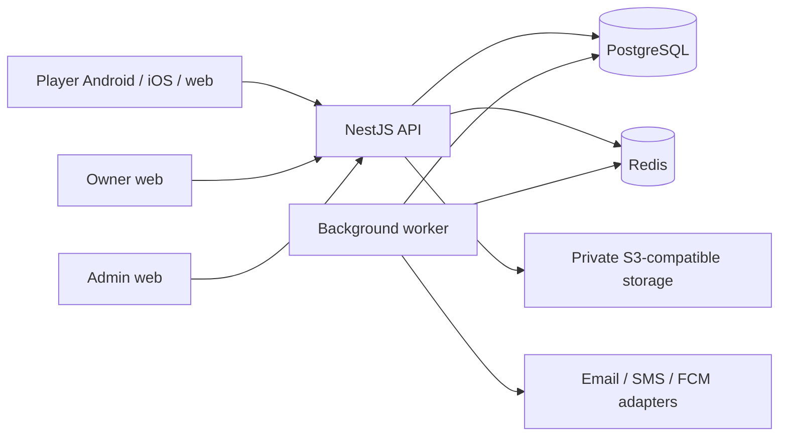

# Architecture

A modular NestJS/TypeScript backend uses Prisma/PostgreSQL for durable state and Redis for caches, throttling and transient coordination. Separate API and background-worker processes share backend modules. Redis never decides booking correctness. OpenAPI is the contract for the generated Dart client. Flutter applications use Riverpod, GoRouter, Dio and Material 3 with shared design and localization packages. Each feature separates presentation, application and data concerns; clients do not duplicate server business rules.

Boundaries: identity/access; businesses/staff; facilities/resources; availability/bookings; games; engagement; moderation; media; notifications; audit. Modules enter the codebase at their roadmap gate, rather than exposing unfinished business endpoints.

Docker deployment remains provider-neutral. Delivery adapters cover email, SMS, FCM and S3-compatible objects. Test adapters must be unmistakably local and forbidden in production. Maps require an approved real provider before launch. No paid provider is selected by this foundation.

Only public health/version endpoints exist in M1. Operational data belongs to later milestones. The worker must not claim successful delivery until a durable adapter result exists.
