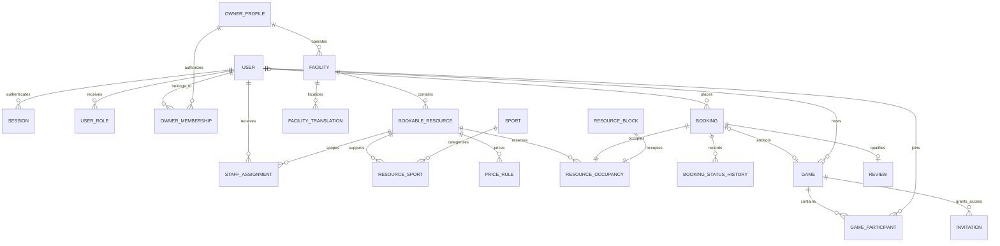

# Database design

M2 introduces the first reviewed migration. M1 does not pretend to provide a booking schema.

Use UUID IDs, foreign keys, timestamps, constrained enums and ownership indexes. Store instants as UTC `timestamptz`; calendar rules retain facility-local wall time and IANA timezone. Money is integer minor units with ISO currency; JSON transports large values as strings. Booking price and cancellation policies are immutable snapshots.

Supporting tables: verification/recovery challenges, operating periods/exceptions, favorites, notification inbox, delivery outbox, media/quarantine, reports, audit events and operation-scoped booking idempotency. Offline reservations optionally link a customer account and require the recording actor plus minimal customer name/contact snapshot.

Use `btree_gist` with an exclusion constraint on `(resource_id WITH =, tstzrange(occupied_start, occupied_end, '[)') WITH &&)` for active occupancy. Occupancy covers reservations AND blocks, including buffers. Add checks for positive ranges and an exclusive booking/block source. Lock the resource for all occupancy/scheduling mutations. Review raw SQL for features Prisma cannot represent. Real PostgreSQL tests are mandatory.

Soft-delete published entities with historical references. Expire/delete temporary credentials and invitations. Final retention periods remain a production policy gate.
