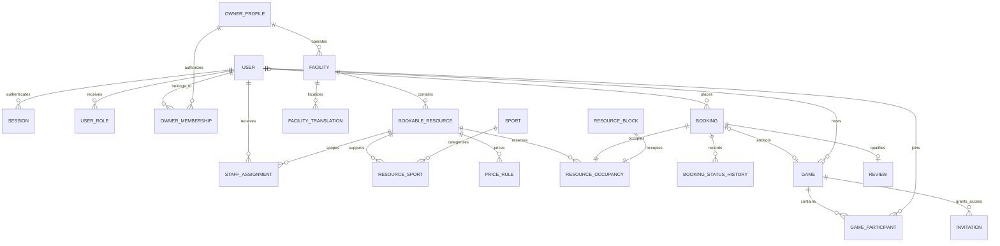

# Database design

M2 introduces the Prisma core schema plus reviewed SQL constraints and deferred source/occupancy consistency triggers. Calendar/pricing configuration, credentials/sessions, media and engagement extensions arrive at their respective milestones.

Use UUID IDs, foreign keys, timestamps, constrained enums and ownership indexes. Store instants as UTC `timestamptz`; calendar rules retain facility-local wall time and IANA timezone. Money is integer minor units with ISO currency; JSON transports large values as strings. Booking price and cancellation policies are immutable snapshots.

Supporting tables: verification/recovery challenges, operating periods/exceptions, favorites, notification inbox, delivery outbox, media/quarantine, reports, audit events and operation-scoped booking idempotency. Offline reservations optionally link a customer account and require the recording actor plus minimal customer name/contact snapshot.

Use `btree_gist` with an exclusion constraint on `(resource_id WITH =, tstzrange(occupied_start, occupied_end, '[)') WITH &&)` for active occupancy. Occupancy covers reservations AND blocks, including buffers. Add checks for positive ranges and an exclusive booking/block source. Lock the resource for all occupancy/scheduling mutations. Review raw SQL for features Prisma cannot represent. Real PostgreSQL tests are mandatory.

Soft-delete published entities with historical references. Expire/delete temporary credentials and invitations. Final retention periods remain a production policy gate.

## M2 migrations

- `202611010001_core`: UUID models, ownership indexes, enums, UTC timestamps, composite resource/source foreign keys, booking/game/audit/outbox/inbox foundations.
- `202611010002_integrity`: btree_gist exclusion, positive ranges, exclusive booking/block source, deferred mandatory covering ledger entry, cancellation/occupancy consistency, active-game uniqueness, valid leases, case-insensitive email uniqueness and append-only audit events.
- `202611010003_snapshots`: translation/link timestamps and immutable booking price/policy snapshots.

The ledger retains inactive cancelled occupancy for history. Completed and no-show bookings retain effective historical occupancy. SQL exclusion protects buffered half-open ranges; deferred triggers require every booking/block to have a ledger entry covering its source range and matching its effective state at commit. A composite foreign key prevents a source on one resource from occupying another resource. Business mutations still must lock their resource row and enforce ownership, publication and scheduling rules in M6/M7; database tests are not evidence that those APIs exist.

`npm run db:migrate` applies reviewed migrations; never use schema push for these custom constraints. Fresh migration and concurrency tests run in an isolated real PostgreSQL service from infra/compose.test.yaml. No production data is used.

## M3 identity migration

Migration `202611010004_identity` adds sessions, hashed refresh credentials, expiring/attempt-limited verification challenges and encrypted MFA fields. Database checks bound session lifetime to 30 days and challenge attempts to five. Existing business data and occupancy constraints are preserved.
